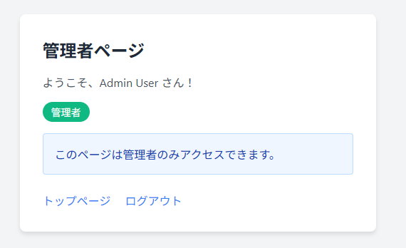

# middleware-app-practice

## 概要
COACHTECH 教材 Tutorial 10-2「ミドルウェア ハンズオン演習」で作成した成果物です。

ミドルウェア学習用アプリを作成した。

## 使用技術

PHP 8.5.12 
Laravel 10.x 
カスタムミドルウェア 
Laravel Fortify（認証）

## 学んだこと

・今回はヒントを見ながら自分ですることが出来た。 
・handleメソッドがどこにあるのか少し迷った。 
・ミドルウェアの実装方法を知った。

## 動作確認

ブラウザを開いて動作確認をした。 
 
 
 
